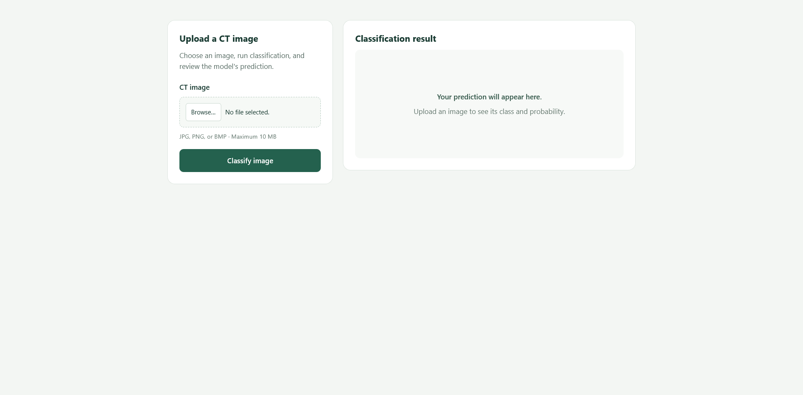
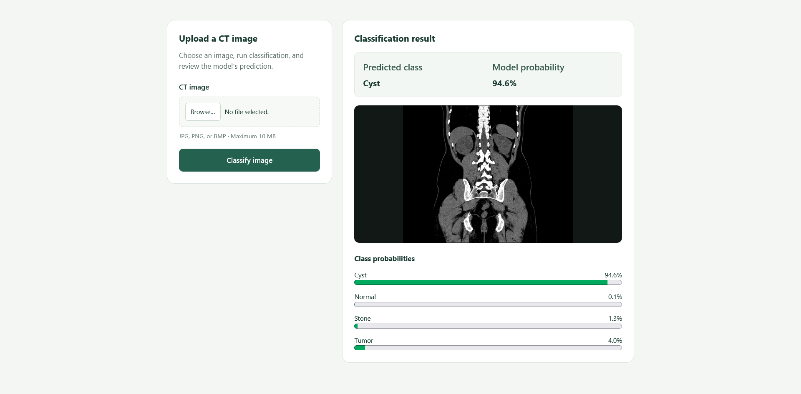
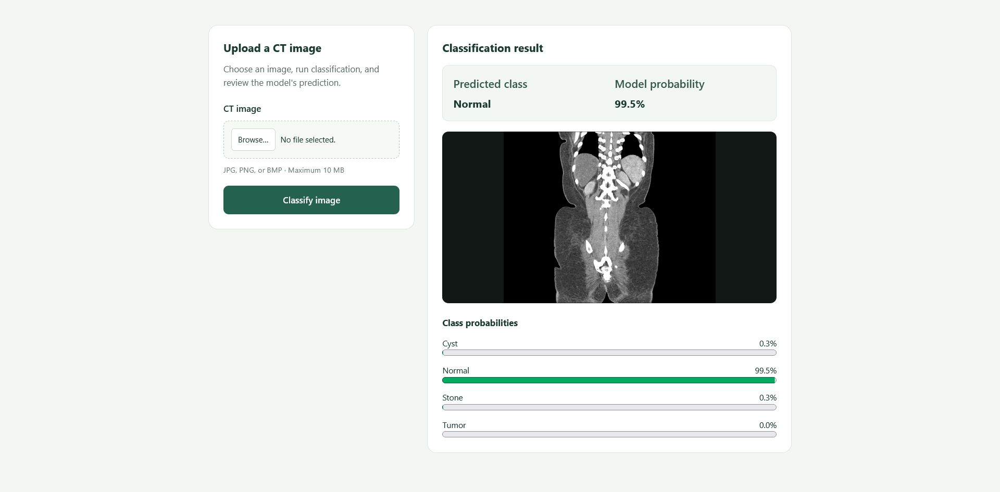
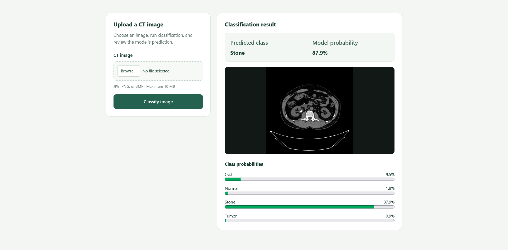
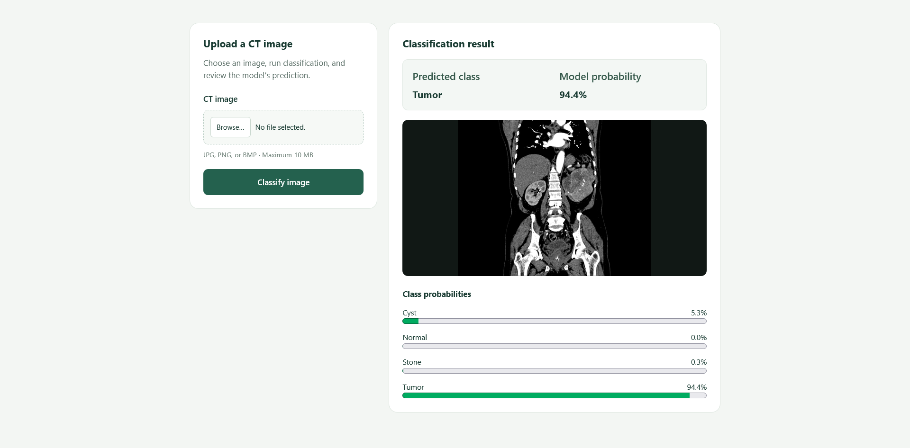
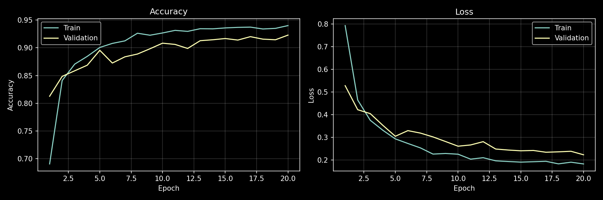
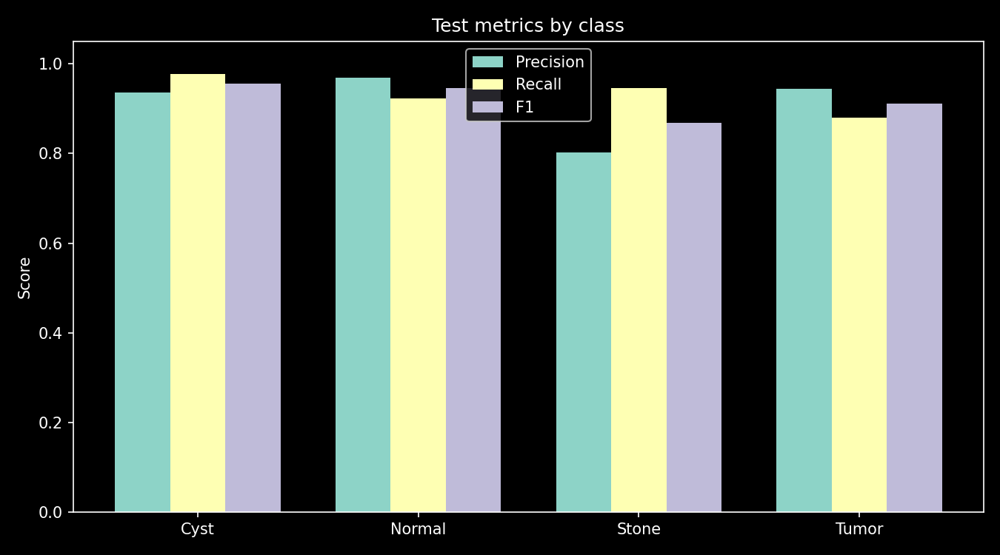
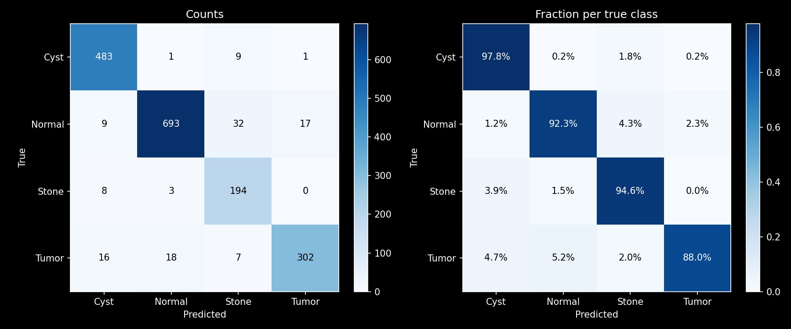

# Kidney CT Classification

Four-class classification of kidney CT images: Cyst, Normal, Stone, and Tumor.
This is a separate project from the kidney stone segmentation application.

## Web interface

Upload a CT image and review the predicted class, its probability, and scores for all four classes.



<details>
<summary>View classification examples for all four classes</summary>

### Cyst



### Normal



### Stone



### Tumor



</details>

## Model training

The Google Colab notebook covers data preparation, classifier training, and evaluation.
The Flask application loads the exported Keras model for image classification.

- [Training notebook](notebooks/kidney_classification.ipynb)
- [Executed training notebook with results (Google Colab)](https://colab.research.google.com/drive/1ZcqliaXV2wsBNN6aVq10CJN2Z3LhQVS_?usp=sharing)
- [Dataset on Kaggle](https://www.kaggle.com/datasets/nazmul0087/ct-kidney-dataset-normal-cyst-tumor-and-stone)

## Dataset

The supplied copy contains 12,446 RGB images. Decoded-pixel comparison found 517 duplicate copies,
with no unreadable files or identical images assigned conflicting labels.

| Class | Original images | Unique images |
| --- | ---: | ---: |
| Cyst | 3,709 | 3,284 |
| Normal | 5,077 | 5,002 |
| Stone | 1,377 | 1,360 |
| Tumor | 2,283 | 2,283 |
| **Total** | **12,446** | **11,929** |

The notebook removes exact duplicates **before** making a stratified 70% / 15% / 15% train/validation/test split.
The provided CSV has no patient IDs, so this is an image-level split.

## Training in Colab

1. Open the notebook in Google Colab and select a T4 GPU runtime.
2. Run the cells in order; `kagglehub` downloads the dataset directly from Kaggle. No ZIP upload is needed.
3. Authorize Google Drive access to save the best model and results.
4. Inspect the dataset examples and class distribution before training.
5. Review the final **test accuracy**, per-class precision/recall/F1, and confusion matrix.

The notebook uses **TensorFlow/Keras** and a pretrained **MobileNetV2** with frozen feature-extractor weights.
A global average pooling layer, dropout, and a four-class softmax layer form the classification head.
Keras loads RGB images at 224×224 and trains the head with `model.fit()`, class-weighted cross-entropy, and Adam.
Callbacks save the best validation-loss model, reduce the learning rate, and stop training early.
Mild augmentation runs only during training. Rescaling from [0, 255] to [-1, 1] is included in the model.

The notebook generates training curves, final metric comparisons, a confusion matrix, and prediction examples.

## Model results

The saved run completed **20 epochs**. The best validation-loss checkpoint achieved
**93.25% test accuracy** and **0.920 macro F1** on the image-level test split.

| Class | Precision | Recall | F1 | Test images |
| --- | ---: | ---: | ---: | ---: |
| Cyst | 0.936 | 0.978 | 0.956 | 494 |
| Normal | 0.969 | 0.923 | 0.945 | 751 |
| Stone | 0.802 | 0.946 | 0.868 | 205 |
| Tumor | 0.944 | 0.880 | 0.911 | 343 |

### Training curves

Training and validation accuracy and loss across epochs.



### Metrics by class

Precision, recall, and F1 on the test set.



### Confusion matrix

Rows show true classes; columns show predictions. Counts and row-normalized fractions are shown side by side.



These plots are the original PNG exports from the saved training run. The split does not establish
patient-level independence; the reported scores describe this dataset split.

## Exported model

[Download the trained model: kidney_classifier.keras (Google Drive)](https://drive.google.com/file/d/1JCiuRQ6XF6szP_Wcah_iiu4TOHP0tDtF/view?usp=sharing)

Download the file and place it in `models/kidney_classifier.keras` at the repository root.
The web application can then run without retraining. Model weights are excluded from Git.

The best checkpoint is saved automatically to:

```text
MyDrive/kidney-classification/kidney_classifier.keras
```

The `.keras` file contains the architecture, preprocessing layers, and trained weights.
A separate `model_info.json` records the class order and input format: 224×224 RGB images with values in [0, 255].
Do not normalize inputs again when using the exported model.
The result graphs, metrics, training history, split manifest, and model information are saved to
`classification_results.zip` in the same Drive folder.
Both files can also be downloaded in the final notebook cell.


## Run the web application

The project uses **Python 3.14**. Install dependencies to reproduce the local environment.
Training remains in Colab; the local application only performs inference, which can run on CPU.

Download the [trained model](https://drive.google.com/file/d/1JCiuRQ6XF6szP_Wcah_iiu4TOHP0tDtF/view?usp=sharing)
and save it as `models/kidney_classifier.keras`. Create the `models/` folder if it does not exist.
The class order is `Cyst, Normal, Stone, Tumor`, as defined in `src/classifier.py`.

From the repository root, create an environment with a compatible Python version and run:

```powershell
py -3.14 -m venv .venv
.\.venv\Scripts\python.exe -m pip install -r requirements.txt
.\.venv\Scripts\python.exe src/app.py
```

Open http://127.0.0.1:5000. Upload a JPG, PNG, or BMP image (maximum 10 MB).
The page shows the image, predicted class, winning probability, and scores for all four classes.
Uploads are processed in memory rather than stored on disk.

- `src/app.py`: Flask routes, upload validation, preview, and error responses.
- `src/classifier.py`: cached model loading, image decoding, preprocessing, and classification.
- `src/templates/index.html` and `src/static/css/style.css`: responsive upload and result page.
- `models/kidney_classifier.keras`: local trained model (not committed).

Preprocessing matches training: RGB conversion, bilinear resizing to 224×224, and float32 pixels in [0, 255].
The exported model already includes normalization. Inference uses `training=False`, disabling augmentation and dropout.
Softmax scores are not calibrated clinical probabilities. This educational application does not provide a medical diagnosis.

## Dataset license and attribution

This project uses **CT KIDNEY DATASET: Normal-Cyst-Tumor and Stone**, published on Kaggle by
**MD NAZMUL ISLAM (nazmul0087)**.

- [Original dataset and data card](https://www.kaggle.com/datasets/nazmul0087/ct-kidney-dataset-normal-cyst-tumor-and-stone)
- Dataset license listed by Kaggle: **Creative Commons Attribution 4.0 International (CC BY 4.0)**.
- [License terms](https://creativecommons.org/licenses/by/4.0/)
